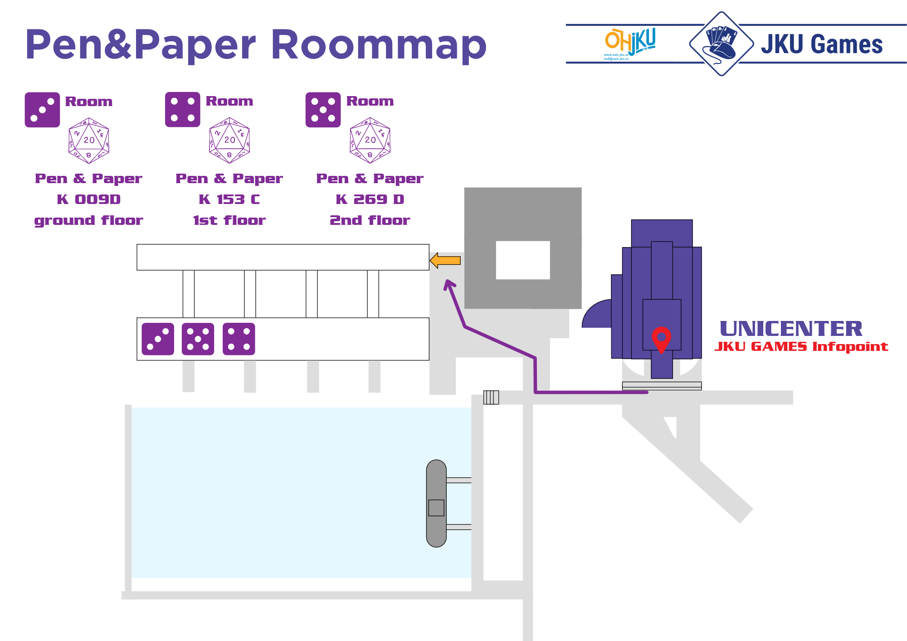
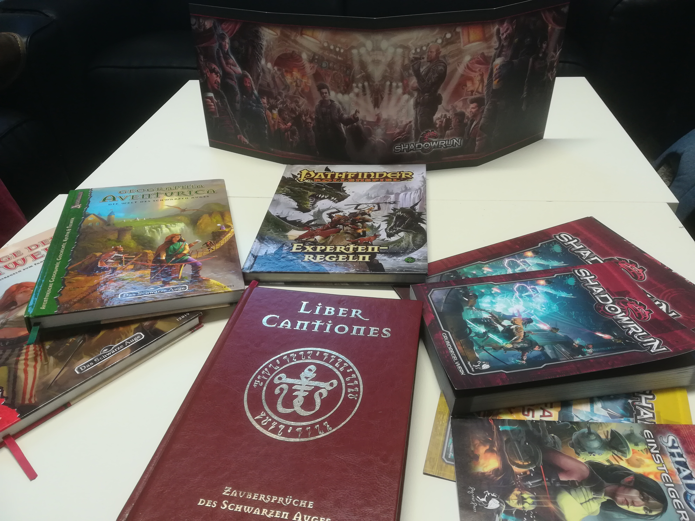

<figure>
  
    <figcaption></figcaption>
</figure>

<!--  -->

## Welcome, Traveller!

In this semester’s JKU Games you will get a chance to try out several Pen & Paper games. Old veteran or completely new 
to the game, we have got you covered! If you want to join an adventure, get a ticket using the button below and be 
here on time! Please <b style="color:red;">sign up for only one game</b> at this time, remaining spots will be available at the Infopoint on 
the Event. 

<!-- **Note: <b style="color:red;">The ticket shop has not yet opened.</b> Check back regularly to not miss anything. 
We will also announce the start of the ticket shop on Discord.** -->

<a href="https://pretix.eu/gamesjku/W26/" target="_blank" rel="noopener noreferrer" class="button img">Get a free ticket!</a>

You can also contact some of the Game-Masters beforehand via <a class="dotted" href="{{ site.discord_url }}" target="_blank">Discord</a>! 
(IDs are in brackets after their Names)

### Roomplan

This semester our Pen & Paper games will take place in rooms on the first and second floor of the Unicenter as well as the ground, 
first and second floor of the Kepler Building:

<figure>
  
    <figcaption></figcaption>
</figure>

<!--
<figure>
  
    <figcaption></figcaption>
</figure>
-->

 This is our schedule - check out our Discord server for spontaneous adventures and updates:

## Friday

### 16:00

| Adventure        | Die verschwundene Karawane   |
|------------------|------------------------------------------------------------------------------------------------------------------------------------------------------------------------------------------------------------------------------------------------------------------------------------------------------------------------------------------------------------------------------------------------------------------------------------------------------------------------------------------------------------------------------------------------------------------------------------------|
| Language         | Deutsch|
| Game-Master      | Stefan [stefan041110] |
| Rules            | DnD 5e |
| Suitable for     | Neulinge willkommen! Regeln werden am Tisch erklärt. Sowohl Neulinge als auch DnD Veteranen sind herzlich willkommen:) |
| Description      | Vor etwa einem Monat brach eine Karawane der Handelsgilde auf, um die Wüste von Azmarin zu durchqueren und die Dörfer jenseits der Dünen mit Waren zu versorgen. Ihre Wagen waren mit wertvollen Stoffen, Gewürzen und Edelmetallen beladen. Doch die Karawane erreichte ihr Ziel nie.  Nun schickt die Gilde euch auf ihre Spur. Ihr sollt das Schicksal der Vermissten aufklären und wichtige Artefakte aus ihrer Fracht bergen, bevor der Wüstenwind die letzten Hinweise verschüttet. Euch erwarten sengende Hitze, eisige Nächte und ein Geheimnis, das gelüftet werden muss. |
| Trigger Warnings | Dieser One-shot enthält Beschreibungen von Tod und Verwundungen in u.a. Kampfsituationen. Der genaue Härtegrad der Beschreibungen kann vor Ort abgeklärt werden. |
| Players          | 5 |
| Duration         | 6h |
| Characters       | am Tisch erstellt oder von den Spielern mitgebracht (Level 3 Charaktere, Standard DnD- Rassen und Klassen, teamfähig) |

| Adventure        | Dungeon-Crawling Jam 2 |
|------------------|-------------------------------------------------------------------------------------------------------------------------------------------------------------------------------------------------------------------------------------------------------------------------------------------------------------------------------------------------------------------------------------------------------------------------------------------------------------------------------------------------------------------------------------------------------------------------------------------------------------------------------------------------------------------------------------------------------------------------------------------------------------------------------------------------------------------------------------------------------------------------------------------------------------------------------------------------------------------------------------------------------------------------------------------------------------------------------------------------------------------------------------|
| Language         | English |
| Game-Master      | Oleg [oleg_ywh] |
| Rules            | Grotten: 1-Bit Deeper |
| Suitable for     | Newbies welcome! Rules will be explained at the table. |
| Description      | Who are you? Some sort of a circus troupe? Cultists? What are you looking for in this endless dungeon? It matters not, even if you find it, there is no way you find your way out of Grotten!  A unique dungeon-crawling adventure completely improvised by the players and the GM at the table with help of a little chaotic book full of random tables. Rules-light and incredibly player-friendly system, enjoyed by new and experienced players alike. We had a blast playing it at the last JKU Games, looking forward to see what kind of story emerges this time.  While often tongue-in-cheek, the game can sometimes be lethal to the characters in which case new characters are created and inserted into the plot instantly. Check this <a href="https://www.youtube.com/watch?v=cEercpeRZ58" target="_blank"> Youtube video </a> by MysteryQuest if you would like to have an idea of how the game can be played.  Bringing a pencil, an eraser and a set of RPG dice is encouraged but not mandatory. Being ready to collaborate with other players on an awesome story and have a great time is. |
| Trigger Warnings | The planned tone of the adventure is “somewhat gloomy and macabre while slightly silly fantasy”, please, do not hesitate to let me know over Discord if you have any concerns regarding the tone or any topics you would like to avoid in the game. |
| Players          | 6 |
| Duration         | 4h |
| Characters       | rolled at the table - am Tisch erstellt|

| Adventure        | Flying Thief |
|------------------|-------------------------------------------------------------------------------------------------------------------------------------------------------------------------------------------------------------------------------------------------------------------------------------------------------------------------------------------------------------------------------------------------------------------------------------------------------------------------------------------------------------------------------------------------------------------------------------------------|
| Language         | Deutsch |
| Game-Master      | Lea [sakinora] |
| Rules            | DnD 5e |
| Suitable for     | Neulinge willkommen! Regeln werden am Tisch erklärt. |
| Description      | Achtung Achtung! Weihnachten steht kurz vor dem aus, denn Santa braucht den Passierschein W26 um durch das Land von Mirabillis durchreisen zu dürfen. Der Beamte, der diesen nach Crystaltide hätte bringen sollen, wurde von einem Griffon angegriffen und die Dokumente wurden dabei gestohlen. Eure Aufgabe ist es, den Gipfel der Frosty Cliffs zu erklimmen und das Nest des Griffons nach den Dokumenten abzusuchen, denn das ist schneller als die Bürokratie nochmal zu wiederholen. Doch hütet euch vor den Gefahren der Frosted Plains, damit ihr nicht selber geborgen werden müsst! |
| Trigger Warnings | detaillierte Beschreibungen von zb. Verletzungen oder Drama. Safety Tools werden erklärt und sind im Spiel verfügbar. |
| Players          | 6 |
| Duration         | 5h |
| Characters       | vom GM mitgebracht oder von den Spielern mitgebracht (Level 2, Kein Flug, Kein Homebrew, Kontrolle durch DM bis 9.Dezember via Discord) |

## Saturday

### 10:00

| Adventure        | Local Legends |
|------------------|------------------------------------------------------------------------------------------------------------------------------------------------------------------------------------------------------------------------------------------------------------------------------|
| Language         | German or English |
| Game-Master      | Wolfgang [wolfgang2703] |
| Rules            | Custom, but don't worry it's really simple |
| Suitable for     | Newbies welcome! Rules will be explained at the table. - Neulinge willkommen! Regeln werden am Tisch erklärt.|
| Description      | Your friend, a wizard, hired you to accompany him to a rural town, where he plans to research the local history. However, a historic artifact has been stolen from the library just before your arrival! Where has it gone and how does it connect to your fried's research? |
| Trigger Warnings | Logic and word puzzles |
| Players          | 4 |
| Duration         | 2h |
| Characters       | rolled at the table - am Tisch erstellt |

| Adventure        | Saturnine Chalice - Where Angels Fear to Tread |
|------------------|-----------------------------------------------------------------------------------------------------------------------------------------------------------------------------------------------------------------------------------------------------------------------------------------------------------------------------------------------------------------------------------------------------------------------------------------------------------------------------------------------------------------------------------------------------------------------------------------------------------------------------------------------------------------------------------------------------------------------------------------------------------------------------------------------------------------------------------------------------------------------------------------------------------------------------------------------------------------------------------------------------------------------------------------------------------------------------------------------------------------------------------------------------------------------------------------------------------------|
| Language         | English or German |
| Game-Master      | Gabriel [toaster8503] |
| Rules            | Call of Cthulhu |
| Suitable for     | Newbies welcome! Rules will be explained at the table. - Neulinge willkommen! Regeln werden am Tisch erklärt.|
| Description      | During your road trip, your car breaks down on the road between two cities. An empty gas tank wouldn’t normally be a problem, but unfortunately, you’re miles away from any civilization on the map. Luckily, not too far from your car, you find a mansion—a huge estate with a two-story house, a large garage, and a mausoleum decorated with angel icons. You’re welcomed by a hospitable and helpful family, but the longer you stay, the stranger they seem. And the longer you stay, the more certain you become that they aren’t the only ones here… - Während eurer Buchtour stirbt am Weg zwischen zwei Städten euer Auto ab. Ein leerer Benzintank wäre sonst kein Problem, doch leider seid ihr meilenweit entfernt von jeglicher Zivilisation auf der Karte. Zum Glück findet ihr nicht allzu weit von eurem Auto eine Villa - ein riesiges Grundstück mit einem zweistöckigen Haus, einer großen Garage und einem Mausoleum, dekoriert mit Engelsikonen. Empfangen werdet ihr von einer gastfreundlichen und hilfsbereiten Familie, doch je länger ihr bleibt, desto komischer wirken sie. Und je länger ihr bleibt, desto sicherer seid ihr euch, dass sie nicht die einzigen hier sind... |
| Trigger Warnings | Horror, Death, Gore, Brutal Murder |
| Players          | 5 |
| Duration         | 5h |
| Characters       | provided by GM - vom GM mitgebracht |

| Adventure        | The Scarlet Ring                                                                                                                                                                                                                                                                                                                                                                                                                                                                                                                                                                                                                                                                                                                                                                                                                                                                                                                                                |
|------------------|-----------------------------------------------------------------------------------------------------------------------------------------------------------------------------------------------------------------------------------------------------------------------------------------------------------------------------------------------------------------------------------------------------------------------------------------------------------------------------------------------------------------------------------------------------------------------------------------------------------------------------------------------------------------------------------------------------------------------------------------------------------------------------------------------------------------------------------------------------------------------------------------------------------------------------------------------------------------|
| Language         | English                                                                                                                                                                                                                                                                                                                                                                                                                                                                                                                                                                                                                                                                                                                                                                                                                                                                                                                                                         |
| Game-Master      | Max [minermax555]                                                                                                                                                                                                                                                                                                                                                                                                                                                                                                                                                                                                                                                                                                                                                                                                                                                                                                                                               |
| Rules            | d20 based homebrew rules                                                                                                                                                                                                                                                                                                                                                                                                                                                                                                                                                                                                                                                                                                                                                                                                                                                                                                                                        |
| Suitable for     | Newbies welcome! Rules will be explained at the table, suitable as a first Pen&Paper Experience.                                                                                                                                                                                                                                                                                                                                                                                                                                                                                                                                                                                                                                                                                                                                                                                                                                                                |
| Description      | Victorian London, 1855.  A year has passed since you and your companions unraveled a grim case of illness, death, and conspiracy. Your investigative talents, highly praised by the press, have not gone unnoticed. A cryptic letter from a solicitor reaches you, urging your presence at Addington Palace. You are tasked with safeguarding a priceless inheritance during the proceedings following the death of the esteemed aristocrat, Margaret Mallan. Drawn in by curiosity, you soon find yourself at the heart of a complex criminal investigation—one filled with the hunt for clues, intense interrogations, sharp deductions, and, ultimately, delivering justice to those who deserve it.   Note: this is a soft sequel to my adventure "The Green Death" I previously ran at 3 past JKU Games. The plot is not connected to the old adventure, but it follows the same playable characters. Both new and returning players are welcome! |
| Trigger Warnings | potential death / serious injury of a child; description kept relatively tame                                                                                                                                                                                                                                                                                                                                                                                                                                                                                                                                                                                                                                                                                                                                                                                                                                                                                   |
| Players          | 6                                                                                                                                                                                                                                                                                                                                                                                                                                                                                                                                                                                                                                                                                                                                                                                                                                                                                                                                                               |
| Duration         | 6h                                                                                                                                                                                                                                                                                                                                                                                                                                                                                                                                                                                                                                                                                                                                                                                                                                                                                                                                                              |
| Characters       | provided by GM                                                                                                                                                                                                                                                                                                                                                                                                                                                                                                                                                                                                                                                                                                                                                                                                                                                                                                                                                  |

### 14:00

| Adventure        | Meteoritenabwurf verschoben |
|------------------|--------------------------------------------------------------------------------------------------------------------------------------------------------------------------------------------------------------|
| Language         | Deutsch |
| Game-Master      | Felaxo [.felaxo.] |
| Rules            | DnD 5e |
| Suitable for     | Neulinge willkommen! Regeln werden am Tisch erklärt.|
| Description      | Der Meteor wurde automatisch aufgeschoben, weil das königliche Himmelssystem keine Katastrophen an Feiertagen zulässt.  Die Gruppe Abenteurer hat nun die Welt zu retten.  Zumindest bis Montag. |
| Trigger Warnings | Bürokratie |
| Players          | 5 |
| Duration         | 4h |
| Characters       | vom GM mitgebracht oder von den Spielern mitgebracht |

| Adventure        | Rache & Recht|
|------------------|------------------------------------------------------------------------------------------------------------------------------------------------------------------------------------------------------------------------------------------------------------------------------------------|
| Language         | Deutsch|
| Game-Master      | Andreas [Yewstone#5583]|
| Rules            | Avatar:Legends|
| Suitable for     | Neulinge willkommen! Regeln werden am Tisch erklärt.|
| Description      | Ihr seit eine Gruppe der Schutzwache der Jasmine-Insel. Avatar Roku ist nicht mehr und der neue Avatar ist verschwunden. So gibt es nun niemanden mehr der die Feuernation aufhalten kann auf ihrem Vormasch. Ihr könnt zwar nicht das Erdkönigreich retten, aber vielleicht eure Insel. |
| Trigger Warnings | -|
| Players          | 5|
| Duration         | 6h|
| Characters       | vom GM mitgebracht|

### 16:00

| Adventure        | Der Fluch von Tannhall|
|------------------|---------------------------------------------------------------------------------------------------------------------------------------------------------------------------------------------------------------------------------------------------------------------------------------------------------------------------------------------------------------------------------------------------------------------------------------------------------------------|
| Language         | Deutsch|
| Game-Master      | Oliver [stormcorp]|
| Rules            | DnD 5e|
| Suitable for     | Neulinge willkommen! Regeln werden am Tisch erklärt.|
| Description      | Eine Gruppe von Abenteurern, angeheuert, um einen Wagen über einen Gebirgspass zu eskortieren, gerät unerwartet in einen heftigen Schneesturm. Schutz kann nur noch das nahe Dorf Tannhall bieten, welches gerade mitten in den Vorbereitungen für das nahende Lichterfest steckt. Doch schnell ist klar: Hier stimmt etwas ganz und gar nicht. Als sich in der eisigen Kälte unheimliche Gestalten erheben, liegt es an den Abenteurern, das Dorf zu retten. |
| Trigger Warnings | Gewalt, milde Gruselelemente, möglicher Tod von Spielercharakteren|
| Players          | 6|
| Duration         | 6h|
| Characters       | am Tisch erstellt|

| Adventure        | The Bandits of N-sky Uyezd|
|------------------|-------------------------------------------------------------------------------------------------------------------------------------------------------------------------------------------------------------------------------------------------------------------------------------------------------------------------------------------------------------------------------------------------------------------------------------------------------------------------------------------------------------------------------------------------------------------------------------------------------------------------------------------------------------------------------------------------------------------------------|
| Language         | Russian|
| Game-Master      | Sasha [.off.]|
| Rules            | Savage Worlds|
| Suitable for     | Newbies welcome! Rules will be explained at the table.|
| Description      | In faraway N-sky Uyezd, life goes on as it always has: peasants till their fields, noblemen manage their estates, and old veterans polish their muskets with bricks. But now merchants are being robbed and travelers murdered. An envoy of His Excellency the Governor has hired you for a seemingly simple job: find the bandits' lair and bring them to justice. For a handsome reward, naturally!  Play a group of disreputable mercenaries in a fantasy world inspired by Nikolai Gogol's Dead Souls, with a touch of magic. Before confronting a deadly gang of bandits, you'll have to survive provincial society. Expect eccentric characters and a mostly lighthearted adventure with some very real dangers. |
| Trigger Warnings | death and violence|
| Players          | 5|
| Duration         | 5h|
| Characters       | provided by GM - vom GM mitgebracht|
